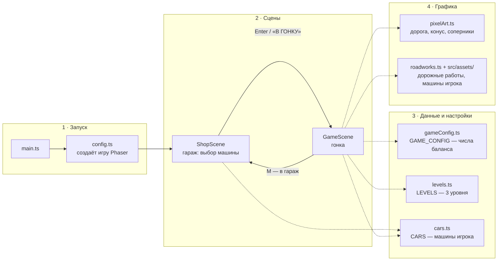
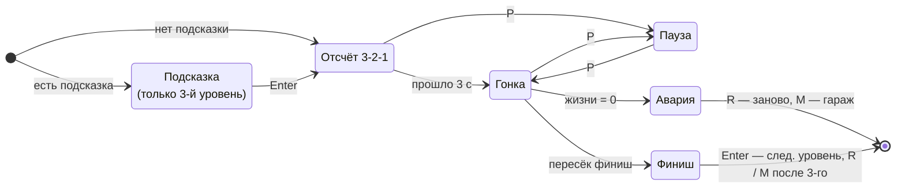
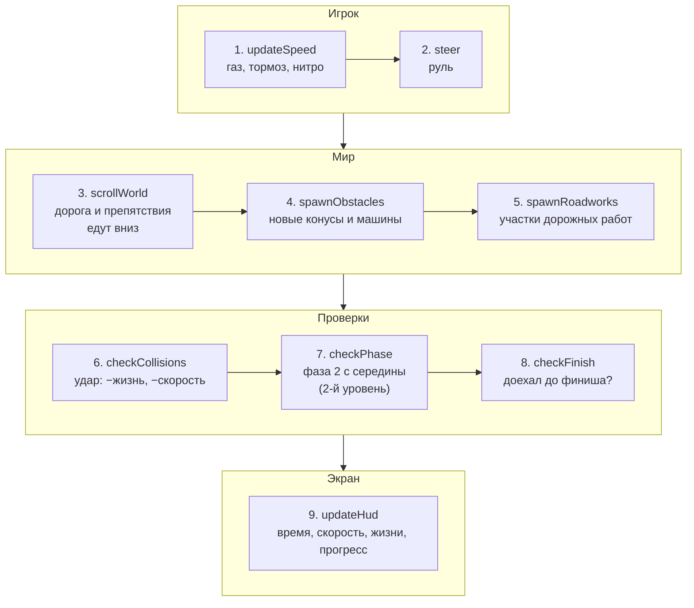

# Архитектура «Пиксельных гонок» — как есть сейчас

Схема реальной игры, а не «идеальной архитектуры». Три части:

1. [Из чего состоит игра](#1-из-чего-состоит-игра) — файлы и кто кого запускает.
2. [Состояния гонки](#2-состояния-гонки) — что происходит от старта до финиша.
3. [Один кадр гонки](#3-один-кадр-гонки) — что по порядку делает `update()`.

---

## 1. Из чего состоит игра

Сплошная стрелка — запускает. Пунктир — берёт данные или настройки.

| Файл | За что отвечает |
|---|---|
| `main.ts`, `config.ts` | запуск: размер экрана, пиксельная графика, список сцен |
| `ShopScene.ts` | гараж: карточки машин, листание, сохранение выбора |
| `GameScene.ts` | вся гонка: управление, препятствия, столкновения, фазы, финиш, интерфейс |
| `gameConfig.ts` | все числа баланса в одном объекте `GAME_CONFIG` |
| `levels.ts` | настройки трёх уровней и правила фазы 2 (`withPhase2`) |
| `cars.ts` | список машин игрока, сохранение выбора в браузере |
| `pixelArt.ts` | текстуры, нарисованные кодом |
| `roadworks.ts` | спрайты, анимации и раскладка участка дорожных работ |

---

## 2. Состояния гонки

Поле `state` в `GameScene`. Перезапуск уровня и переход на следующий идут через одну
функцию `goToLevel()`.

---

## 3. Один кадр гонки

Пока идёт гонка, `update()` примерно 60 раз в секунду вызывает функции строго по порядку.
Все числа они берут из `GAME_CONFIG` и настроек уровня.

### Кто чьё состояние меняет

| Функция | Что меняет |
|---|---|
| `updateSpeed`, `steer` | скорость, таймеры нитро, положение машины игрока |
| `scrollWorld` | пройденный путь, позиции дороги и препятствий; удаляет уехавшее за экран |
| `spawnObstacles`, `spawnRoadworks` | список препятствий, перекрытую полосу |
| `checkCollisions` | жизни, скорость, неуязвимость; при 0 жизней — состояние «Авария» |
| `checkPhase` | фазу и действующие правила (`rules = withPhase2(level)`), цвет трассы |
| `checkFinish` | состояние «Финиш», рекорд уровня, общее время забега |
| пауза (P) | состояние «Пауза»; при продолжении сдвигает таймеры на длину паузы |
| `goToLevel` | перезапускает сцену с данными забега (номер уровня, общее время) |
