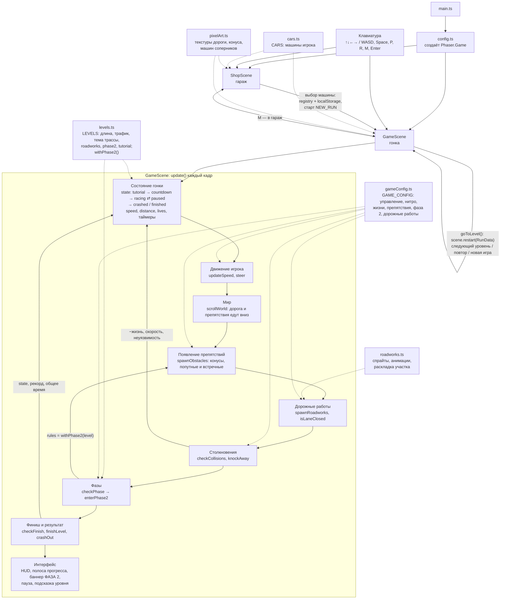

# Архитектура «Пиксельных гонок» — как есть сейчас

Это схема реальной игры, а не «идеальной архитектуры». Сплошная стрелка — вызывает / запускает,
пунктир — читает данные или настройки.

## Кто чьё состояние меняет

| Часть | Что меняет |
|---|---|
| `ShopScene` | выбранную машину (`registry`, `localStorage`), запускает `GameScene` |
| `updateSpeed` / `steer` | `speed`, нитро-таймеры, позицию машины игрока |
| `scrollWorld` | `distance`, позиции дороги, препятствий и финиша; удаляет уехавшее за экран |
| `spawnObstacles` / `spawnRoadworks` | список `obstacles`, перекрытую полосу (`closedLane`) |
| `checkCollisions` | `lives`, `speed`, неуязвимость; при 0 жизней — `state = crashed` |
| `checkPhase` | `phase`, действующие правила `rules`, цвет трассы |
| `checkFinish` / `finishLevel` | `state = finished`, рекорд уровня, общее время забега |
| пауза (`P`) | `state = paused`, сдвигает таймеры на длину паузы |
| `goToLevel` | перезапускает сцену с `RunData` (номер уровня, общее время) |

## Где искать числа

- **Баланс** (скорость, нитро, жизни, доли препятствий, фаза 2, дорожные работы) — `GAME_CONFIG` в `src/game/gameConfig.ts`.
- **Уровни** (длина, трафик, тема трассы, есть ли фаза 2 и дорожные работы, подсказка) — `LEVELS` в `src/game/levels.ts`.
- **Машины игрока** — `CARS` в `src/game/cars.ts`.
